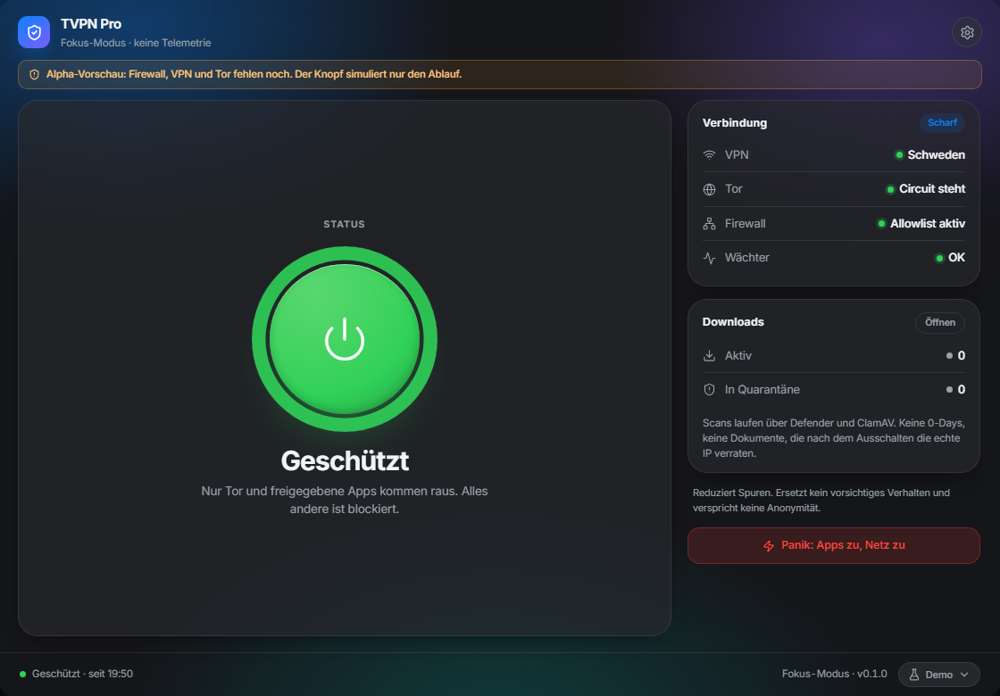
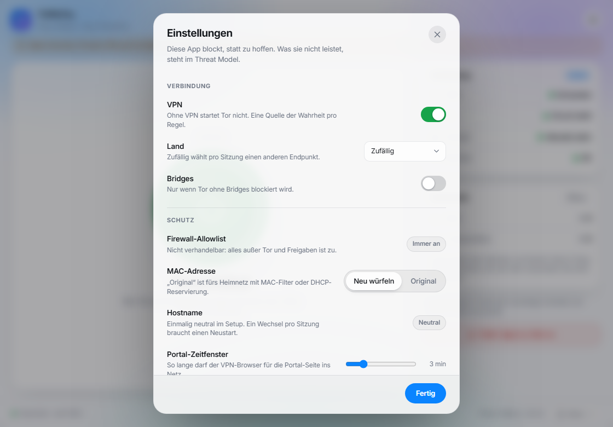

# TVPN Pro

> **Status: Alpha. Diese Version schützt noch nichts.**
> Firewall, VPN und Tor sind nicht implementiert. Der große Knopf simuliert nur den geplanten Ablauf. Die App kann Dateien herunterladen (direkt oder über einen bereits laufenden Tor-Proxy) und zeigt die geplante Oberfläche.

> **English:** TVPN Pro is an early alpha of a one-click privacy tool for Windows. It does **not** protect you yet: no firewall, no VPN, no Tor integration. We are looking for contributors who know the Windows Filtering Platform, Tor, or Rust/Tauri. See [CONTRIBUTING.md](CONTRIBUTING.md).

Ein Klick soll später: Firewall scharf, MAC wechseln, VPN verbinden, Tor starten, Tor Browser und Downloader öffnen, Downloads prüfen, alles überwachen und beim Ausschalten sauber abbauen. Das ist der Plan. Gebaut ist bisher das Fundament.

## Was heute funktioniert

| Bereich | Stand |
|---|---|
| Oberfläche (Svelte 5, Tauri 2) | Alle elf Zustände, Einstellungen, Sitzungs-Zusammenfassung, Hell/Dunkel, macOS-artiges Fenster |
| Download (Desktop) | Echt: HTTPS über `reqwest`, Routen **Direkt** und **Über Tor** (lokaler SOCKS-Proxy 9150), SHA-256, Abbruch löscht die Datei |
| Download-Liste | Fortschritt, Urteile, Route, Aufräumen |
| Torrent-Vertrag | Nur über VPN erlaubt, Standard blockiert; die VPN-Route braucht den Dienst, der noch fehlt |
| Service-Kern | Zustandsautomat, Settings-Whitelist, URL-/Magnet-Regeln, IPC-Envelope, Redaktions-Scanner, 48 Tests |
| Tests | `just verify`, 4 Playwright-E2E-Tests, 4 Tauri-Tests |
| Defender-Scan | Wird versucht; läuft Defender nicht, lautet das Urteil ehrlich „Unklar" |

## Was ausdrücklich fehlt

- **Firewall (WFP)**, Kill-Switch, Allowlist, Recovery.
- **VPN** (Mullvad-CLI) und **Tor-Controller**; die Tor-Route nutzt nur einen vorhandenen Proxy.
- **MAC-Wechsel**, Hostname, Portal-Erkennung.
- **Tor Browser** starten und prüfen, **aria2**, Scanner-Pipeline mit EICAR, MOTW, Quarantäne.
- **Wächter**, Notfall-Reset, Installer mit Signierung, USB-Kit.
- **macOS**.
- Spikes S1 bis S6 und die Leak-Matrix in der VM.

Kurz: Das Gerüst steht, der Schutz fehlt. Wer die App als „anonym" verkauft, lügt.

## Screenshots





## Selbst bauen

Voraussetzungen: Windows 11, Rust (stable, MSVC), Visual Studio Build Tools mit C++-Workload, Windows SDK, Node 26+, bun, git.

```powershell
git clone https://github.com/Creeper100GB/TVPN-Pro.git
cd TVPN-Pro
just verify                 # fmt, clippy, Tests, PowerShell-Check, Redaktions-Gate
cd ui
bun install
bun run dev                 # Browser-Vorschau auf 5173
bun run tauri dev           # echtes Fenster (baut die Rust-Shell)
```

`just test` lädt die MSVC-Umgebung über `tools/with-msvc.ps1`; ein normales Terminal hat `LIB`/`INCLUDE` nicht.

Release-Build (unsigniert, SmartScreen warnt):

```powershell
cd ui
bun run tauri build
```

Der Installer landet unter `ui/src-tauri/target/release/bundle/nsis/`.

## Routen und Grenzen

| Route | Was passiert | Grenze |
|---|---|---|
| Über Tor | HTTPS über einen lokalen SOCKS-Proxy auf `127.0.0.1:9150` | Braucht einen laufenden Tor-Proxy; ohne ihn Fehler |
| Direkt | HTTPS ohne Tunnel | Ungeschützt: der Server sieht deine echte IP |
| Über VPN | wird abgelehnt | Braucht `tvpnd` und die WFP-Firewall |
| Torrent | nur mit `torrent_mode = vpn_only` | Ohne VPN-Route gesperrt; nie über Tor |

Dateien landen in `%USERPROFILE%\Downloads\TVPN`. Bei Abbruch wird die Datei gelöscht.

## Mitmachen: ausdrücklich erwünscht

Wenn du dich mit einer dieser Sachen auskennst, hilf mit. Auch Reviews und ehrliche Kritik sind willkommen.

- **Windows Filtering Platform:** persistente Filter, Interface-Bedingungen, Koexistenz mit Mullvad.
- **Tor:** eigener `tor.exe`, Control-Port, Isolationsports, Tor Browser am System-Tor.
- **Mullvad-CLI:** Lockdown, Serverwahl, Status, Fehlerfälle.
- **Rust/Tauri:** IPC über Named Pipes mit ACL, Dienste, Installer, Code-Signing.
- **QA:** Leak-Tests in der VM, Canary, Fuzzing der Pipe, Redaktions-Gate.
- **macOS:** NetworkExtension oder `pf`, MAC-Wechsel, Notarisierung.

Startpunkte: Issues mit `help wanted` und `good first issue`. Regeln und Ablauf stehen in [CONTRIBUTING.md](CONTRIBUTING.md). Du kannst auf Deutsch oder Englisch beitragen.

## Sicherheit

Bitte Sicherheitslücken **nicht** als öffentliches Issue melden. Nutze „Report a vulnerability" im Security-Tab des Repos. Details: [SECURITY.md](SECURITY.md).

## Lizenz

GPL-3.0-or-later, siehe [LICENSE](LICENSE). Beiträge werden unter derselben Lizenz eingebracht.

Die App reduziert später Spuren, ersetzt aber kein vorsichtiges Verhalten und verspricht keine Anonymität.
