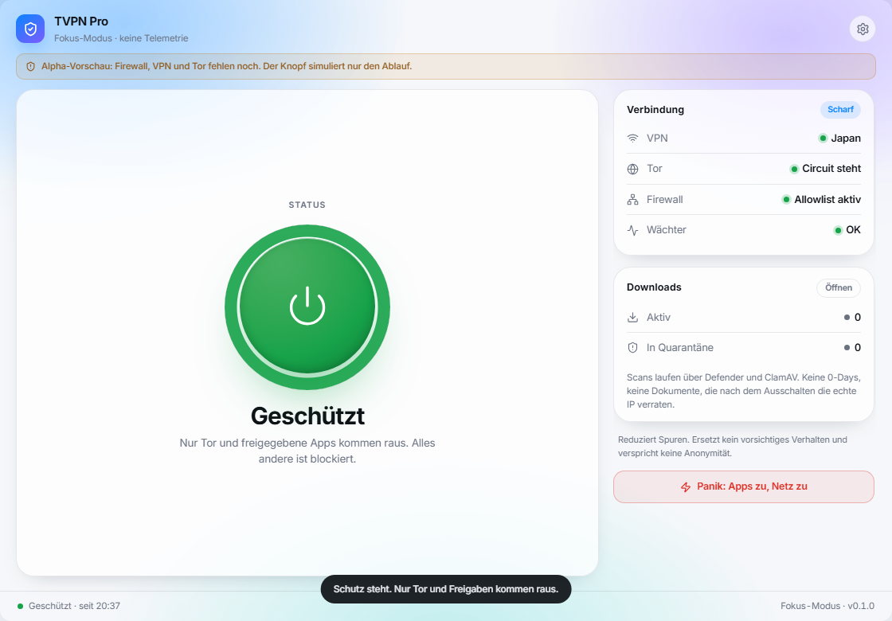

# TVPN Pro

> **Status: Alpha. Firewall und Tor sind verdrahtet; die VPN-Kette ist ungeprüft.**
> Der Windows-Dienst setzt Firewall und Tor. Die VPN-Kette braucht die Mullvad-App und ein Konto und ist ohne beides ungeprüft. Der große Knopf startet den echten Dienst; ohne Dienst zeigt die App den Fehlerzustand.

> **English:** TVPN Pro is an early alpha of a one-click privacy tool for Windows. The Windows service can arm a WFP default-deny firewall and a local Tor circuit. The VPN leg requires the Mullvad app and account and is unverified. No anonymity guarantee.

Ein Klick startet den Dienst: Firewall scharf, Tor starten, Downloads prüfen, alles überwachen und beim Ausschalten sauber abbauen. Die VPN-Kette und die MAC-/Hostname-Funktionen sind noch nicht vollständig geprüft.

## Installieren

### Windows 10/11 (x64)

**Ohne Installation, direkt starten.** Datei herunterladen, doppelklicken, fertig. Keine Kommandozeile.

[**Portable EXE herunterladen**](https://github.com/Creeper100GB/TVPN-Pro/releases/latest/download/TVPN-Pro-Windows-x64-Portable.exe)

Die portable EXE ist nur die Oberfläche; sie enthält weder Dienst noch Tor und schützt allein nichts. Für den echten Schutz den Installer verwenden.

**Mit Dienst, Tor, Startmenü-Eintrag und Deinstaller.** Datei herunterladen, doppelklicken, Installer bestätigen.

[**Installer herunterladen**](https://github.com/Creeper100GB/TVPN-Pro/releases/latest/download/TVPN-Pro-Windows-x64-Setup.exe)

Beide Builds sind unsigniert. Windows SmartScreen warnt beim ersten Start: **Weitere Informationen** → **Trotzdem ausführen**. Die SHA-256-Prüfsummen stehen in [SHA256SUMS.txt](https://github.com/Creeper100GB/TVPN-Pro/releases/latest/download/SHA256SUMS.txt). Windows 11 hat WebView2; Windows 10 braucht die WebView2-Runtime. Der Installer lädt sie bei Bedarf nach, die portable EXE nicht.

<details>
<summary><strong>Alternativ per PowerShell installieren</strong></summary>

```powershell
irm https://raw.githubusercontent.com/Creeper100GB/TVPN-Pro/main/install.ps1 | iex
```

Das Skript sucht den neuesten Release, lädt den Installer, prüft die SHA-256-Prüfsumme und startet ihn. Es installiert nichts ohne deine Zustimmung. Den Code kannst du vorher lesen: [`install.ps1`](install.ps1).

</details>

### Winget

Das Manifest liegt im Repository und ist mit `winget validate` geprüft. Lokal:

```powershell
winget install --manifest packaging\winget\manifests\c\Creeper100GB\TVPNPro\0.1.6
```

Nach der Aufnahme in `microsoft/winget-pkgs`:

```powershell
winget install --id Creeper100GB.TVPNPro -e
winget upgrade --id Creeper100GB.TVPNPro -e
```

Winget erkennt auch eine über GitHub installierte `0.1.5` am ARP-Eintrag
`TVPN Pro` / `TVPN Pro Contributors` und kann sie auf `0.1.6` aktualisieren.
Der ARP-Publisher des ausgelieferten `0.1.6`-Installers ist `TVPN Pro
Contributors`; `ZenSquirrel` gilt erst für neu gebaute Installer.
Winget läuft nicht automatisch im Hintergrund; das Upgrade wird bewusst
angestoßen. Details: [`docs/WINGET.md`](docs/WINGET.md).

### macOS (Apple Silicon, in Vorbereitung)

Es gibt noch keinen öffentlichen macOS-Download. Der Build-Check läuft in der CI; Signierung und Notarisierung fehlen. Sobald ein Release da ist, installiert dieses Skript:

```bash
curl -fsSL https://raw.githubusercontent.com/Creeper100GB/TVPN-Pro/main/install.sh | bash
```

Bis dahin baut die CI eine unsignierte `.app` als Artefakt. Gatekeeper blockiert sie; Details stehen in [`ui/README.md`](ui/README.md).

> **Was die App nicht kann:** Ohne Mullvad-Konto und -App ist die VPN-Kette ungeprüft. MAC-Wechsel und Hostname sind im Hyper-V-Test nicht umgesetzt (S3: Neustart nötig). Die App reduziert keine Spuren und verspricht keine Anonymität.

## Was heute funktioniert

| Bereich | Stand |
|---|---|
| Oberfläche (Svelte 5, Tauri 2) | Alle elf Zustände, Einstellungen, Sitzungs-Zusammenfassung, Hell/Dunkel, macOS-artiges Fenster |
| Download (Desktop) | Echt: HTTPS über `reqwest`, Routen **Direkt** und **über Tor** (lokaler SOCKS-Proxy 9150), SHA-256, Mark-of-the-Web für jede abgelegte Datei, Quarantäne bei Fund (als Quarantäne gezählt), Abbruch löscht die Datei |
| Download-Liste | Fortschritt, Urteile, Route, Aufräumen |
| Torrents | **Nicht implementiert.** Magnet-Links werden abgelehnt. Es läuft kein Torrent-Client, es wird nichts geseedet. Eine `.torrent`-Datei über HTTPS ist ein gewöhnlicher Datei-Download: sie wird geprüft und abgelegt, aber weder geöffnet noch geseedet. |
| Dienst `tvpnd` | Protokoll, Named Pipe mit Token/ACL, enable/disable/panic/recover, Dienstinstallation, echte WFP-/Tor-/Mullvad-Anbindung |
| WFP | Default-Deny plus Tor-/Mullvad-Permit; in der VM 12 Filter, Verkehr blockiert; Interface-Bindung (S1) offen |
| Tor | Control-Client und echter `tor.exe`; in der VM Bootstrap 100 und Circuit |
| VPN | Mullvad-CLI-Wrapper; ohne Konto und App ungeprüft |
| Wächter | Hintergrund-Wächter alle 5 s plus Status-Poll; eigener Prozess offen |
| Panik | UI-Button, Tray-Menü und globaler Hotkey `Ctrl+Alt+Shift+F12`: beendet Tor und VPN, entfernt die Firewall, das Netz ist danach **offen**; danach öffnet sich die Sitzungs-Zusammenfassung (eine Panik aus `Aus` erzeugt keine neue); Schließen blendet ins Tray |
| Installer | NSIS perMachine mit Dienst und Tor; in der VM Installation, Enable, Panik und Uninstall grün; unsigniert |
| Tests | `just verify` (Service- und Shell-Tests, UI-Unit-Tests, Checks), Playwright-E2E, VM-Smoke-Tests, Installer-Smoke |
| macOS-Build | Ad-hoc signierte `.app` aus der CI; kein Schutz, keine Notarisierung |

## Was ausdrücklich fehlt

- **S1 / Mullvad**: Die WFP-Permits sind an die App-ID gebunden, nicht an das VPN-Interface. Ohne Mullvad-Konto und -App ist die VPN-zu-Tor-Kette ungeprüft.
- **MAC-Wechsel**: Primitive und Tests stehen; der Hyper-V-Adapter meldet `unsupported`. Der echte Adapter-Write muss auf physischer Hardware geprüft werden.
- **Hostname**: S3 verlangt einen Neustart; die UI zeigt `hostname_unchanged`. Die einmalige Neutralisierung im Setup fehlt.
- **Torrents**: Nicht implementiert. Ein BitTorrent-Client bräuchte die verifizierte VPN-Interface-Bindung und eine Upload-Regel; beides fehlt. Magnet-Links werden abgelehnt, es wird nichts geseedet.
- **Tor Browser starten**, Block-Erkennung und Fallback-Browser, aria2 und die VPN-Download-Route.
- **Eigener Wächterprozess**: Der Wächter läuft im Dienst, nicht als getrennter Prozess. Tray-Icon und Panik-Hotkey funktionieren.
- **Code-Signierung**, USB-Kit und Update-Kanal.
- **macOS-Schutzfunktionen** (Firewall, VPN, MAC). Ein unsignierter Build-Check läuft in der CI, signiert und notarisiert ist nichts.
- Spikes S2, S4, S5, S6 und die vollständige Leak-Matrix in der VM.

Kurz: Firewall und Tor sind verdrahtet, die VPN-Kette und die Hardware-Features sind es nicht. Wer die App als "anonym" verkauft, lügt.

## Screenshots




Die Bilder zeigen einen älteren Build: dort heißen die Zustände noch anders
(„Geschützt“ statt „Tor aktiv“), die Panik-Schaltfläche ist anders beschriftet
und der Downloader nennt noch ClamAV statt Windows Defender. Neu aufnehmen mit
`bun --cwd=ui run preview` und `bun --cwd=ui run shots`.

## Selbst bauen

Voraussetzungen: Windows 11, Rust (stable, MSVC), Visual Studio Build Tools mit C++-Workload, Windows SDK, Node 26+, bun, git.

```powershell
git clone https://github.com/Creeper100GB/TVPN-Pro.git
cd TVPN-Pro
cd ui
bun install                 # zuerst: `just verify` ruft ui-check und ui-build auf
cd ..
just verify                 # alles außer den Playwright-E2E: fmt, clippy, Tests (Service und
                            # Shell), UI-Unit-Tests, PowerShell-Check, Redaktions-Gate,
                            # UI-Check, UI-Build
cd ui
bun run dev                 # Browser-Vorschau auf 5173
bun run tauri dev           # echtes Fenster (baut die Rust-Shell)
```

`just test` lädt die MSVC-Umgebung über `tools/with-msvc.ps1`; ein normales Terminal hat `LIB`/`INCLUDE` nicht.

Release-Build (unsigniert, SmartScreen warnt):

```powershell
cd ui
bun run tauri build
```

Der Installer landet unter `ui/src-tauri/target/release/bundle/nsis/`.

## Routen und Grenzen

| Route | Was passiert | Grenze |
|---|---|---|
| Über Tor | HTTPS über einen lokalen SOCKS-Proxy auf `127.0.0.1:9150` | Braucht einen laufenden Tor-Proxy; ohne ihn Fehler |
| Direkt | HTTPS ohne Tunnel | Ungeschützt: der Server sieht deine echte IP. Solange die Firewall scharf ist, lehnt die Oberfläche die Route ab; ein direkter Download käme an der Allowlist (nur Tor und VPN) ohnehin nicht vorbei |
| Über VPN | wird abgelehnt | Braucht `tvpnd` und die WFP-Firewall |
| Torrent | wird immer abgelehnt | Kein Torrent-Client implementiert: Magnet-Links werden abgewiesen. Eine `.torrent`-Datei über HTTPS ist ein gewöhnlicher Datei-Download und wird weder geöffnet noch geseedet |

Dateien landen in `%USERPROFILE%\Downloads\TVPN`. Bei Abbruch wird die Datei gelöscht.

## Mitmachen: ausdrücklich erwünscht

Wenn du dich mit einer dieser Sachen auskennst, hilf mit. Auch Reviews und ehrliche Kritik sind willkommen.

- **Windows Filtering Platform:** persistente Filter, Interface-Bedingungen, Koexistenz mit Mullvad.
- **Tor:** eigener `tor.exe`, Control-Port, Isolationsports, Tor Browser am System-Tor.
- **Mullvad-CLI:** Lockdown, Serverwahl, Status, Fehlerfälle.
- **Rust/Tauri:** IPC über Named Pipes mit ACL, Dienste, Installer, Code-Signing.
- **QA:** Leak-Tests in der VM, Canary, Fuzzing der Pipe, Redaktions-Gate.
- **macOS:** NetworkExtension oder `pf`, MAC-Wechsel, Notarisierung.

Startpunkte: Issues mit `help wanted` und `good first issue`. Regeln und Ablauf stehen in [CONTRIBUTING.md](CONTRIBUTING.md). Du kannst auf Deutsch oder Englisch beitragen.

## Sicherheit

Bitte Sicherheitslücken **nicht** als öffentliches Issue melden. Nutze „Report a vulnerability" im Security-Tab des Repos. Details: [SECURITY.md](SECURITY.md).

## Lizenz

GPL-3.0-or-later, siehe [LICENSE](LICENSE). Beiträge werden unter derselben Lizenz eingebracht.

Die App reduziert später Spuren, ersetzt aber kein vorsichtiges Verhalten und verspricht keine Anonymität.
